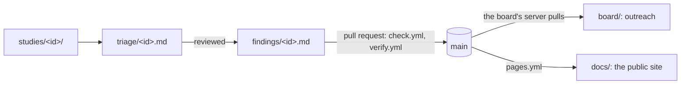

# pq-chain-analysis

What the move to post-quantum cryptography breaks, exposes or leaves unprotected on Ethereum mainnet: the studies that
looked, and what they found, one file per contract and issue. A fork of
[kevaundray/pq-chain-analysis](https://github.com/kevaundray/pq-chain-analysis), where this work started.

- **Rules for findings:** [AGENTS.md](AGENTS.md), for people and agents
- **Report:** [REPORT.md](REPORT.md), the census of pre-quantum cryptography in mainnet contracts (November 2026)
- **Check a contract:** <https://cperezz.github.io/pq-chain-analysis/>, the census and every finding of an address

## How it works



1. A **study** says how something was investigated: goal, setup, procedure, how to reproduce, results, limits. Its
   code lives in another repository, linked at a commit; small result tables sit in its `results/`.
2. A **finding** is one contract and one issue. It starts in `triage/`: `tools/find.py` looks the address up,
   `tools/new_finding.py` writes the facts it reads from the chain at one block, and the author writes the judgment
   and the `checks` that back it. `tools/build.py` checks the format; `tools/verify.py` re-runs the facts and the
   checks on an archive node.
3. Someone other than the author reviews it and moves it to `findings/`. Its card is what readers see; its Reviewer
   notes are never shown.
4. Every push and pull request runs `.github/workflows/check.yml`: the rules and their self-test, the outreach board's
   check and import of every card, and the public site's data built from that import. `main` takes only pull
   requests whose `check` and `board` jobs pass.
5. A pull request that adds or changes cards is also checked by `verify.yml` (`tools/verify_pr.py`): Claude re-reads
   every card against an archive node, its facts, checks, source and transaction traces, and the pull request is
   merged when every card holds. Otherwise its comment lists the cards in doubt and a maintainer reviews it.
6. After a merge to `main`, `pages.yml` publishes the site with that commit's cards, and the board's server pulls it
   and rebuilds its database within a minute.

Format-1 files in `findings/` (from the EIP-8151 study) and the root-issue entries
`triage/eip-8151-*.md` were filed in bulk, by rules, before anyone read the contracts. `review/` turns them into cards,
one contract at a time.

## Layout

| Path | What it holds | Its rules |
|---|---|---|
| `studies/<id>/` | One folder per study | [`studies/README.md`](studies/README.md) |
| `triage/` | New entries until someone else has reviewed them; the EIP-8151 root-issue entries | [`AGENTS.md`](AGENTS.md) |
| `findings/` | One file per contract and issue: format 2 (the reviewed cards) and format 1 (bulk entries waiting for review) | [`AGENTS.md`](AGENTS.md) |
| `review/` | The EIP-8151 review: the open rows, their dossiers, its tools and its agents' instructions | [`review/README.md`](review/README.md) |
| `patterns.md` | The patterns (`PQ-n`) findings are grouped by, each with its category and the words a card shows | |
| `code/` | Decompiled code that findings link, for contracts without verified source | [`code/README.md`](code/README.md) |
| `templates/` | Blank forms; `examples/` holds filled ones, which the rules are tested against | |
| `tools/` | `build.py` (the rules and their self-test), `find.py`, `new_finding.py`, `verify.py`, `verify_pr.py` (the pull request verifier), `site_data.py` (the site's data), `tokens.json` (the tokens a value counts) | Each file's docstring |
| `board/` | The outreach board: the cards in SQLite, rebuilt whenever `main` changes and checked against the files, and the private page where the outreach team records contact | [`board/README.md`](board/README.md) |
| `docs/` | The public site: `index.html`, and `lookup/`, the census per address (a snapshot built outside this repository); CI adds the cards a reader may see | `tools/site_data.py` |
| `REPORT.md` | The census report | |
| `AGENTS.md` | The rules for findings: levels, the file, checks, severity, filing and reviewing (`CLAUDE.md` points here) | |

## Checking a change

```
uv run tools/build.py --selftest                     # the rules, and proof that they reject what they should
uv run --with pyyaml python board/check.py .         # the board's check
ETH_RPC_URL=<archive node> uv run tools/verify.py findings/<id>.md   # re-run a card's facts and checks
```

## Licence

[CC0 1.0](LICENSE).
