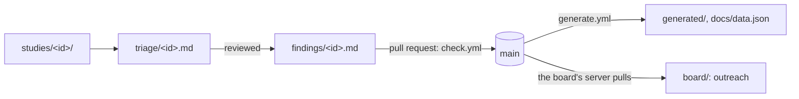

# pq-chain-analysis

What the move to post-quantum cryptography breaks, exposes or leaves unprotected on Ethereum mainnet: the studies that
looked, and what they found, one file per contract and issue.

- **Findings:** [by severity](generated/INDEX.md) · [by pattern](generated/PATTERNS.md) · [by study](generated/STUDIES.md) · [not yet reviewed](generated/TRIAGE.md)
- **Report:** [REPORT.md](REPORT.md), the census of pre-quantum cryptography in mainnet contracts (November 2026)
- **Check an address:** <https://kevaundray.github.io/pq-chain-analysis/>, the census site in `docs/`

## How it works



1. A **study** says how something was investigated: goal, setup, procedure, how to reproduce, results, limits. Its
   code lives in another repository, linked at a commit; small result tables sit in its `results/`.
2. A **finding** is one contract and one issue. It starts in `triage/`: `tools/find.py` looks the address up,
   `tools/new_finding.py` writes the facts it reads from the chain at one block, and the author writes the judgment
   and the `checks` that back it. `tools/build.py --check` checks the format; `tools/verify.py` re-runs the facts and
   the checks on an archive node.
3. Someone other than the author reviews it and moves it to `findings/`. Its card is what readers see; its Reviewer
   notes are never shown.
4. Every push and pull request runs `.github/workflows/check.yml`: the rules and their self-test, and the outreach
   board's check and import of every card.
5. After a merge to `main`, `generate.yml` rebuilds `generated/` and `docs/data.json` and commits them, and the board's
   server pulls `main` and rebuilds its database within a minute.

Format-1 files in `findings/` (from the EIP-8151 study and the first study) and the root-issue entries
`triage/eip-8151-*.md` were filed in bulk, by rules, before anyone read the contracts. `review/` turns them into cards,
one contract at a time.

## Layout

| Path | What it holds | Its rules |
|---|---|---|
| `studies/<id>/` | One folder per study | [`studies/README.md`](studies/README.md) |
| `triage/` | New entries until someone else has reviewed them; the EIP-8151 root-issue entries | [`triage/README.md`](triage/README.md) |
| `findings/` | One file per contract and issue: format 2 (the reviewed cards) and format 1 (bulk entries waiting for review) | [`findings/README.md`](findings/README.md): format, levels, severity, checks, filing |
| `review/` | The EIP-8151 review: the open rows, their dossiers, its tools and its agents' instructions | [`review/README.md`](review/README.md) |
| `patterns.md` | The patterns (`PQ-n`) findings are grouped by, each with its category and the words a card shows | |
| `code/` | Decompiled code that findings link, for contracts without verified source | [`code/README.md`](code/README.md) |
| `outreach/` | One file per project: where contact with its team stands (none yet) | [`outreach/README.md`](outreach/README.md) |
| `templates/` | Blank forms; `examples/` holds filled ones, which the rules are tested against | |
| `tools/` | `build.py` (the rules, their self-test, `generated/`), `find.py`, `new_finding.py`, `verify.py`, `site_data.py` (`docs/data.json`), `tokens.json` (the tokens a value counts) | Each file's docstring |
| `generated/` | Lists and CSV files built by `build.py`; CI commits them after every merge to `main` | [`generated/README.md`](generated/README.md) |
| `docs/` | The census site: `index.html`, `data.json` (rebuilt by CI), `lookup/` (address lookup, built outside this repository) | |
| `board/` | The outreach board: the cards in SQLite, rebuilt whenever `main` changes and checked against the files, and the private page where the outreach team records contact | [`board/README.md`](board/README.md) |
| `REPORT.md` | The census report | |
| `AGENTS.md` | The rules agents follow (`CLAUDE.md` points here) | |

## Checking a change

```
uv run tools/build.py --check --selftest             # the rules, and proof that they reject what they should
uv run --with pyyaml python board/check.py .         # the board's check
ETH_RPC_URL=<archive node> uv run tools/verify.py findings/<id>.md   # re-run a card's facts and checks
```

Pull requests do not carry `generated/`: CI rebuilds it after the merge (`uv run tools/build.py` previews it).

## Licence

[CC0 1.0](LICENSE).
