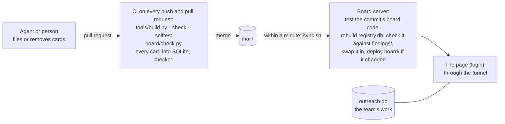

# The outreach board

A private web page for the outreach team: browse, search, sort and filter every reviewed finding (format 2 card) in
`findings/`, and record outreach on each one (status, assignee, comments, with a log of every change).

`findings/` stays the source of truth. The board copies it into SQLite every time `main` changes, checks the copy
against the files, and keeps its own records, the team's work, beside it.

## How it fits together



- **One copy of the findings, rebuilt.** On the server, `sync.sh` runs every minute. When `main` has moved, it tests
  the board code of the new commit (`check.py`), rebuilds `registry.db` from that commit's cards (`ingest.py`), and
  checks the new database against the files: the same cards, each with the SHA-256 of its file. Only then does the new
  database replace the old one. New cards appear, removed ones disappear, edited ones change: the database is always
  exactly one commit of `main`. A commit that changes nothing it is built from (the bot's rebuild of `generated/`)
  costs one `git fetch`.
- **A broken commit changes nothing.** If the check or the import fails, the last good database and code stay, the
  run fails in the journal, and the next minute tries again. CI runs the same check and import on every pull request,
  so a broken card is seen before it is merged.
- **Board code deploys itself.** When `board/` changed, `sync.sh` copies it to the server's `app/` and restarts the
  board, after `check.py` passed on it.
- **The server pulls; nothing pushes to it.** The server needs no open port, and GitHub holds no key to it: it
  reads the repository with a read-only deploy key. Only code merged to `main` runs there.

## Why the database is not in git

`registry.db` is a build product, tens of megabytes and growing as review files the rest of the cards.
Committed, every change of a card would add a new binary copy to the history, and two branches could never be merged.
Built from the commit, it is never out of date and never conflicts. `outreach.db` is written by the page, by several
people at once, many times a minute; it lives only on the server and is backed up there.

## What it holds

| File | What | Where it comes from |
|---|---|---|
| `data/registry.db` | Every card: its fields, what the card keeps but never shows (`admin`, `activity.last`, `primitive`, `checks`, the Reviewer notes), and what the board adds (held now, deployer, gaps) | `ingest.py`, from `findings/` at a commit |
| `data/outreach.db` | Each finding's outreach status and assignee, the log of every change and comment, the accounts | The page |
| `data/values.db` | What every address behind a finding holds now: ETH and every ERC-20 that CoinGecko lists on Ethereum, priced by DefiLlama | `value.py`, run by hand |

Only cards are imported: format 1 files are the bulk rows review has not reached, and each arrives when review files
its card. The server never sends the Reviewer notes, `checks`, `admin`, `activity.last` or `primitive` to the page.
A finding that leaves `findings/` keeps its outreach record (`server.py orphans` lists them); it shows again if the
card comes back under the same id.

## The page

For the outreach team's loop: pick, contact, record, follow up.

- Filters, each with counts under the others and combined: assigned (me, nobody, a person), commented or not,
  outreach status (with how far outreach has got), severity, and under "More" category, pattern, impact, upgradeable,
  study, level and missing data; a finding's project or deployer; held now; search over the cards and the comments.
  The view lives in the address (`#assignee=-&severity=CRITICAL`), so it can be sent as a link.
- The list: status and assignee change in place, the number of comments and the last one, the last change. Select
  rows for a status, an assignee or a comment on all of them.
- A finding: status buttons with what each means, assignee and "Assign to me", the thread (comments, with links, and
  every change), a comment box (⌘/Ctrl + Enter), who to contact (team, contract, deployer, all findings of the same
  project or deployer), the card as `findings/README.md` defines it ("not established" for an empty field), held now.
  `j`/`k` go to the next and previous finding, `/` searches, Esc closes.
- Every change is saved at once and logged. A change to one finding carries what the page showed: if someone changed
  it since, the server refuses (409) and the page shows what is there now. An assignee must have an account. Coming
  back to the tab reloads what others changed.

## Use

From the repository's root; the databases go to `board/data/` (ignored by git):

```
uv run --with pyyaml python board/check.py .                          # the check, 2 s
uv run --with pyyaml python board/ingest.py . board/data/registry.db  # every card of the checkout, checked; 20 to 60 s
python3 board/server.py user NAME                                     # prints a new password; again to reset; --delete
python3 board/server.py serve 8091                                    # then http://127.0.0.1:8091/
```

## Deploy

The server keeps everything in `/home/ubuntu/pq-outreach` (the units name that path and the `ubuntu` user):

| Path | What |
|---|---|
| `registry/` | A shallow clone of this repository on `main`, read with a deploy key |
| `app/` | The deployed copy of `board/`, which the units run |
| `data/` | `registry.db`, `outreach.db`, `values.db`, `backups/` |
| `vdata/`, `.venv/` | `value.py`'s working files and its DuckDB |

| Unit | What |
|---|---|
| `pq-outreach.service` | The board on 127.0.0.1:8090 |
| `pq-outreach-sync.timer` | Every minute: `app/sync.sh` |
| `pq-outreach-backup.timer` | Daily: `data/backups/outreach.db`, over the previous copy |
| `pq-outreach-tunnel.service` | The https address, through a Cloudflare quick tunnel |

First setup, or a move to another server (Python 3 with PyYAML, git, rsync, cloudflared):

```
ssh-keygen -t ed25519 -N '' -f ~/.ssh/pq-chain-analysis        # add the .pub as a read-only deploy key of the repository
git clone --depth 1 --branch main -c core.sshCommand="ssh -i ~/.ssh/pq-chain-analysis -o IdentitiesOnly=yes" \
  git@github.com:kevaundray/pq-chain-analysis.git /home/ubuntu/pq-outreach/registry
sh /home/ubuntu/pq-outreach/registry/board/deploy/install.sh   # units, app/, the first import
cd /home/ubuntu/pq-outreach/app && BOARD_DATA=../data python3 server.py user NAME
```

Protect `main` (pull requests with the `check` workflow passing) so that only checked commits reach the server.

## Operate

- Logs: `journalctl -u pq-outreach -u pq-outreach-sync`. A failed sync names the commit and what failed.
- Add a person: `cd /home/ubuntu/pq-outreach/app && BOARD_DATA=../data python3 server.py user NAME`. After a password
  reset or a delete, `sudo systemctl restart pq-outreach` (logins are cached).
- Restore the outreach records: stop `pq-outreach`, copy `data/backups/outreach.db` over `data/outreach.db`, start it.
  The copy is at most a day old, and there is no older one.
- Refresh the values (about an hour): in `app/`, with `BOARD_DATA=../data`, `rm -r ../vdata/balances
  ../vdata/prices.jsonl ../vdata/markets*.json ../vdata/eth_usd.txt ../vdata/pairs/26400000.parquet` (the last,
  partial partition), then `../.venv/bin/python value.py discover`, `prices`, `balances`, `publish`; the next sync
  imports them. `universe` again only when the flagged code families change.
- The address: `journalctl -u pq-outreach-tunnel | grep -o 'https://.*trycloudflare.com'`. It changes whenever the
  tunnel restarts; a named tunnel in a Cloudflare account of ours gives a fixed one (`cloudflared tunnel login`,
  `tunnel create`, `tunnel route dns`, with its own config file).

## Limits

- The server is Python's standard library server: enough for a team, behind the tunnel.
- Comments cannot be edited or deleted: the log is the record. Correct one with a new comment.
- The backup is one copy on the same server.
- Held now is what the addresses hold, not always what is at risk: a verifier holds nothing while the pools behind it
  do, and a permit token's exposure is its holders' balances. The card's own figure, with its basis, stays beside it.
  Tokens Etherscan prices but CoinGecko does not list at that address count as zero.

## Later: a public search

A site where a team looks its contracts up, like the census's address lookup in `docs/`, can come from the same
import: CI on `main` builds `registry.db` exactly as above (without values), exports the card fields a reader may see,
and publishes static lookup files. Nothing here needs to change for it.
